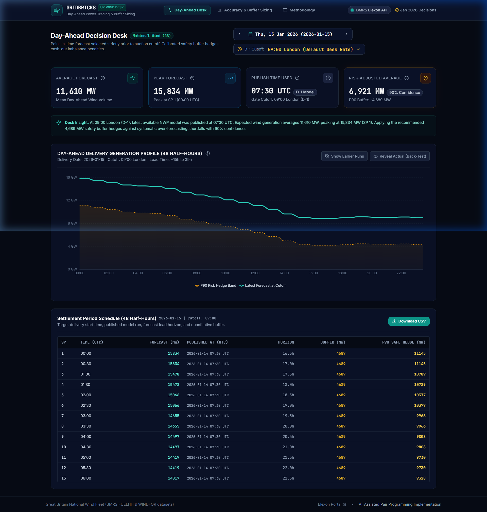
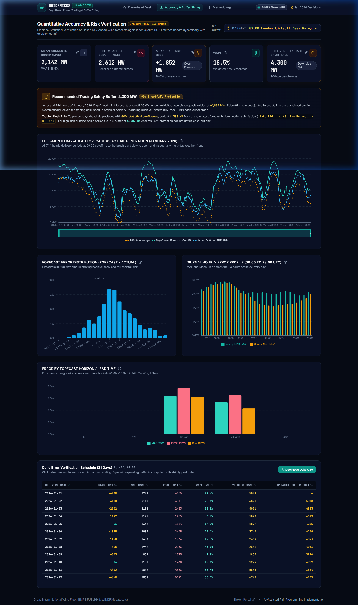
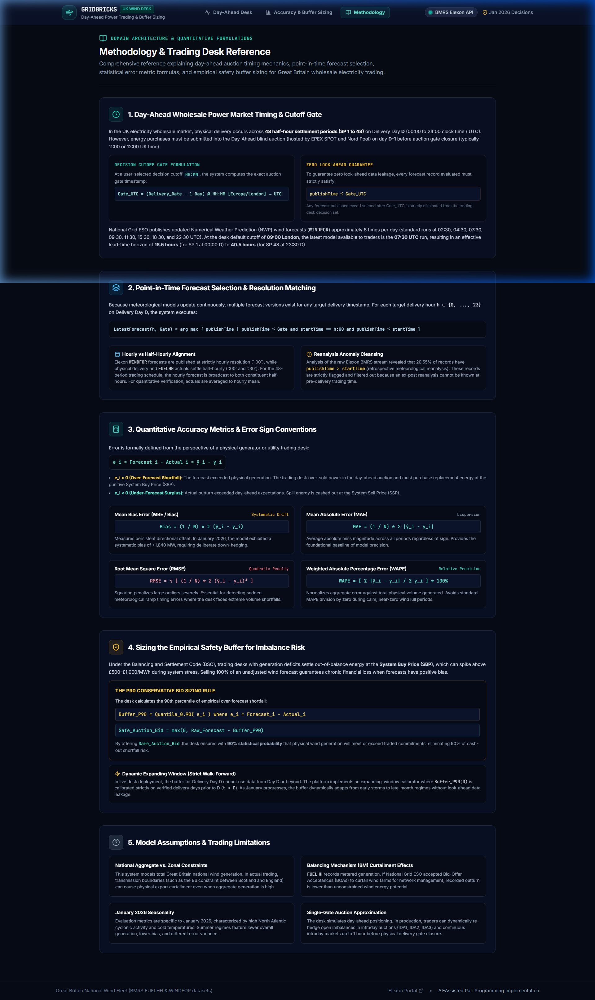

# UK Wind Power Day-Ahead Trading Desk

[](https://github.com/gridbricks/uk-wind-trading-desk/actions/workflows/ci.yml)
[](https://fastapi.tiangolo.com)
[](https://react.dev)
[](https://www.typescriptlang.org)
[](https://www.python.org)
[](https://www.docker.com)
[](https://opensource.org/licenses/MIT)

> **Live Deployment Demo (Vercel)**: [https://uk-wind-trading-desk.vercel.app](https://uk-wind-trading-desk.vercel.app) *(Placeholder)*

---

## Executive Summary

The **UK Wind Power Day-Ahead Trading Desk** is an institutional-grade decision-support platform designed for energy utility traders purchasing power on day $D-1$ before UK power auction gates close (EPEX SPOT and Nord Pool). The platform ingests real-time and historical National Grid wind generation actuals (`FUELHH`) and forecast revisions (`WINDFOR`) from the Elexon Insights API (BMRS), dynamically enforces decision-time cutoffs (e.g. 09:00 or 11:00 London time) to eliminate lookahead bias, and quantifies historical forecast uncertainty.

By combining intraday revision tracking with an asymmetric **P90 safety buffer** (calculated via expanding historical windows) and an interactive **Thermal Procurement & Net Deficit Calculator**, the trading desk can accurately determine how much additional wholesale electricity must be procured (e.g. from CCGT/thermal plants or day-ahead power auctions) to meet consumer demand while insulating the utility from punitive real-time balancing cash-out penalties.

---

## Application Previews

| Day-Ahead Decision Desk | Accuracy & Risk Backtesting |
|:---:|:---:|
|  |  |
| *Latest forecast at 09:00 gate, earlier revision trajectories, asymmetric P90 safety band, and downloadable settlement schedule.* | *Month-long MAE/RMSE/WAPE metrics, diurnal error profiles, horizon decay curves, and 500 MW risk distribution.* |

| Methodology & Gate Reference |
|:---:|
|  |
| *Detailed reference explaining auction gate logic, timezone normalization, mathematical metric definitions, and risk buffer sizing.* |

---

## Directory & File Structure

```text
GridBricks/
├── .github/
│   └── workflows/
│       └── ci.yml                 # GitHub Actions CI workflow (lint, typecheck, pytest, vitest, build)
├── backend/
│   ├── app/
│   │   ├── __init__.py            # Backend package initialization
│   │   ├── analytics.py           # Pure, typed Pandas domain analytics (cutoffs, revisions, errors, buffers)
│   │   ├── api.py                 # FastAPI REST API endpoints, routing, Pydantic schemas, and in-memory caching
│   │   ├── elexon_client.py       # Resilient HTTP client for Elexon Insights API (backoff, timeouts, UTC parsing)
│   │   ├── ingest.py              # CLI data pipeline script for snapshot fetching, deduplication, and export
│   │   ├── models.py              # Internal domain models and data transfer objects
│   │   ├── repository.py          # In-memory thread-safe data repository singleton with live fallback
│   │   └── schemas.py             # Pydantic v2 request/response schemas matching OpenAPI specs
│   ├── data/
│   │   ├── actuals_snapshot.csv.gz    # Compressed National Grid FUELHH actual generation dataset
│   │   └── forecasts_snapshot.csv.gz  # Compressed National Grid WINDFOR forecast revisions dataset
│   ├── tests/
│   │   ├── test_analytics.py      # Unit tests for analytics with hand-computed edge-case fixtures
│   │   ├── test_api.py            # API endpoint integration tests via FastAPI TestClient
│   │   ├── test_elexon_client.py  # Mocked HTTP unit tests for Elexon ingestion client
│   │   ├── test_ingest.py         # Unit tests for CLI ingestion script and deduplication
│   │   └── test_repository.py     # Repository caching, querying, and fallback tests
│   ├── Dockerfile                 # Multi-stage slim Python 3.11 container with unprivileged user
│   ├── requirements.txt           # Production Python dependencies and quality toolpins
│   └── pyproject.toml             # Configuration for Ruff linter/formatter, Mypy, and Pytest
├── frontend/
│   ├── public/
│   │   └── favicon.svg            # Vector turbine SVG favicon
│   ├── src/
│   │   ├── components/            # Reusable UI component library
│   │   │   ├── __tests__/         # Vitest + React Testing Library component tests
│   │   │   ├── AppShell.tsx       # Navigation header, live status, and layout wrapper
│   │   │   ├── ChartCard.tsx      # Composable card container with header actions and full-screen view
│   │   │   ├── CutoffSelect.tsx   # Interactive gate cutoff selector (09:00, 11:00, 12:00, 14:00)
│   │   │   ├── DateStepper.tsx    # Delivery date carousel navigation with dropdown picker
│   │   │   ├── EmptyState.tsx     # Graceful empty data indicator
│   │   │   ├── ErrorState.tsx     # Resilient network error retry card
│   │   │   ├── InfoTooltip.tsx    # Accessible floating metric definitions tooltip
│   │   │   ├── KpiCard.tsx        # High-contrast KPI tile with glow accents and trend indicators
│   │   │   └── SkeletonLoader.tsx # Shimmer loading animation for async queries
│   │   ├── lib/
│   │   │   ├── api.ts             # Typed REST fetch client for backend endpoints
│   │   │   └── utils.ts           # Number formatting (MW/GW), date helpers, and class merging
│   │   ├── pages/
│   │   │   ├── AccuracyPage.tsx   # Comprehensive backtest, error distributions, and diurnal analysis
│   │   │   ├── DayAheadDeskPage.tsx # Core trading view with latest forecast, risk band, and revisions
│   │   │   └── MethodologyPage.tsx# Educational documentation of formulas, auction rules, and assumptions
│   │   ├── App.tsx                # Client-side router configuration
│   │   ├── index.css              # Custom styling, dark navy color palette, and glowing effects
│   │   ├── main.tsx               # Application root mount with TanStack Query provider
│   │   └── test/setup.ts          # Vitest and jest-dom matchers configuration
│   ├── Dockerfile                 # Multi-stage production container with Nginx reverse proxy
│   ├── nginx.conf                 # Nginx proxy routing /api to backend:8000 with gzip compression
│   ├── package.json               # Frontend dependencies and npm scripts
│   ├── tailwind.config.js         # Tailored energy trading color system (Navy, Teal, Amber, Rose)
│   ├── tsconfig.json              # TypeScript strict compiler configuration
│   └── vite.config.ts             # Vite bundler and local development proxy configuration
├── docs/
│   ├── ARCHITECTURE.md            # Detailed system architecture and Mermaid data flow diagrams
│   ├── ASSUMPTIONS.md             # Comprehensive domain assumptions, trade-offs, and limitations
│   ├── DATA_FINDINGS.md           # Empirical analysis and observations from Elexon BMRS API exploratory pass
│   └── screenshots/               # High-resolution application screenshots
├── scripts/
│   └── explore_elexon.py          # Data discovery script verifying Elexon API parameters and distributions
├── .dockerignore                  # Docker build context exclusions
├── .gitignore                     # Git tracking exclusions
├── .pre-commit-config.yaml        # Git pre-commit hooks (Ruff, Mypy, trailing whitespace)
├── docker-compose.yml             # Single-command local container orchestration
└── README.md                      # Primary project documentation and quickstart guide
```

---

## Quickstart: Running the Application

### Option A: Running with Docker (Recommended)

The easiest way to run the full application with all services pre-configured:

#### Prerequisites
- [Docker Engine](https://docs.docker.com/engine/install/) (v24.0+)
- [Docker Compose](https://docs.docker.com/compose/install/) (v2.20+)

#### Launch Services
```bash
# Clone the repository
git clone https://github.com/gridbricks/uk-wind-trading-desk.git
cd uk-wind-trading-desk

# Build and start all containers in detached mode
docker compose up --build -d
```

#### Access Endpoints
- **Frontend Web UI**: [http://localhost:3000](http://localhost:3000)
- **FastAPI Backend**: [http://localhost:8000](http://localhost:8000)
- **Interactive OpenAPI Documentation**: [http://localhost:8000/docs](http://localhost:8000/docs)
- **API Health Check**: [http://localhost:3000/api/health](http://localhost:3000/api/health)

To view live container logs or shut down:
```bash
docker compose logs -f
docker compose down
```

---

### Option B: Running Locally Without Docker

#### Prerequisites
- **Python**: 3.11, 3.12, or 3.13
- **Node.js**: 20.x or 22.x LTS and `npm`

#### 1. Backend Setup
```bash
# Navigate to backend directory
cd backend

# Create and activate a virtual environment
python -m venv venv
# On Windows:
.\venv\Scripts\activate
# On Linux / macOS:
source venv/bin/activate

# Install dependencies
pip install -r requirements.txt

# Start FastAPI development server
uvicorn app.api:app --host 0.0.0.0 --port 8000 --reload
```
The backend is now live at `http://localhost:8000`.

#### 2. Frontend Setup
In a separate terminal:
```bash
# Navigate to frontend directory
cd frontend

# Install npm dependencies
npm install

# Start Vite development server
npm run dev
```
The frontend is now accessible at `http://localhost:5173` (with Vite automatically proxying `/api` calls to `http://localhost:8000`).

---

## How to Refresh the Data

The repository includes pre-ingested, deduplicated snapshots covering **2025-12-31 to 2026-02-02** in `backend/data/`. To refresh or extend this dataset directly from the Elexon Insights API:

```bash
# Ensure virtualenv is active
cd backend

# Fetch and overwrite snapshots for a custom date range
python -m app.ingest --from 2025-12-31 --to 2026-02-02 --output-dir backend/data

# Or refresh using specific dates
python -m app.ingest --from 2026-01-01 --to 2026-01-31
```

### Ingestion CLI Parameters:
- `--from YYYY-MM-DD`: Start of the ingestion interval (inclusive).
- `--to YYYY-MM-DD`: End of the ingestion interval (inclusive).
- `--output-dir PATH`: Directory to store compressed `.csv.gz` files (defaults to `backend/data/`).
- `--timeout SECONDS`: HTTP request timeout budget per chunk (default: `30`).

---

## Key Domain Assumptions

For an exhaustive discussion of design trade-offs, refer to [docs/ASSUMPTIONS.md](docs/ASSUMPTIONS.md). Key desk principles include:

1. **Strict Auction Gate Cutoff (Zero Lookahead Bias)**:
   Power auctions for delivery day $D$ close on day $D-1$ (e.g. 09:00 for desk preparation, 11:00 for EPEX auction gate). A forecast published at 11:05 on $D-1$ cannot physically be used for bidding. The system strictly selects the latest forecast satisfying:
   $$\text{publishTime} \le \text{cutoff}_{\text{UTC}}(D-1)$$
2. **Europe/London Timezone Canonical Gate**:
   Trading cutoffs operate in UK civil time (`Europe/London`). Cutoffs are dynamically converted to UTC accounting for Daylight Saving Time (GMT vs BST).
3. **Hourly vs. Half-Hourly Resolution**:
   `WINDFOR` forecasts provide hourly average power; `FUELHH` actuals provide 30-minute settlement period power. By default, the system aggregates actuals to hourly resolution ($(\text{SP}_{2i-1} + \text{SP}_{2i}) / 2$) for like-for-like physical energy comparison.
4. **Asymmetric Risk Sizing (P90 Over-Forecast)**:
   Under-forecasting yields unexpected spill power (often sellable at cashout). Over-forecasting creates physical shortfalls that force the utility into the penal System Buy Price (SBP) imbalance market. The safety buffer is thus sized against the **90th percentile of positive errors ($\text{Forecast} - \text{Actual} > 0$)**.
5. **Expanding Window Backtesting**:
   The recommended buffer for day $D$ is strictly calculated using historical errors from preceding days $[D_{start}, D-1]$. This guarantees that safety recommendations never leak future data into past decisions.

---

## Metric Definitions

| Metric | Formula | Trading Desk Interpretation |
|:---|:---|:---|
| **Bias (Mean Error)** | $\frac{1}{N} \sum (\hat{y}_t - y_t)$ | Systematic over-forecasting ($>0$) or under-forecasting ($<0$). Positive bias indicates structural risk of shortfall. |
| **MAE** | $\frac{1}{N} \sum \|\hat{y}_t - y_t\|$ | Mean Absolute Error. Expected magnitude of forecast deviation regardless of direction. |
| **RMSE** | $\sqrt{\frac{1}{N} \sum (\hat{y}_t - y_t)^2}$ | Penalizes large outlier errors quadratically; critical for identifying extreme wind ramps or storm events. |
| **WAPE** | $\frac{\sum \|\hat{y}_t - y_t\|}{\sum y_t} \times 100\%$ | Weighted Absolute Percentage Error. Volume-weighted percentage error unaffected by zero-generation division. |
| **P50 / P90 / P95 Abs Error** | Quantiles of $\|\hat{y}_t - y_t\|$ | Distribution of error magnitudes. P90 represents the 1-in-10 worst deviation magnitude. |
| **P90 Over-Forecast Error** | 90th percentile of $(\hat{y}_t - y_t \mid \hat{y}_t > y_t)$ | Recommended safety buffer to cover 90% of shortfall events without over-hedging. |
| **Accuracy Band ($\pm 10\%$)** | $\% \text{ of periods with } \frac{\|\hat{y}_t - y_t\|}{y_t} \le 10\%$ | Percentage of delivery periods where the forecast was within standard operational tolerance. |

---

## Testing & Quality Hardening

The repository enforces strict linting, type safety, and test coverage standards:

### 1. Backend Quality Suite
```bash
cd backend

# Lint and check style with Ruff
ruff check .
ruff format --check .

# Static type checking with Mypy
mypy app

# Run Pytest suite with code coverage report
python -m pytest --cov=app --cov-report=term-missing
```

#### Coverage Highlights:
- **`backend/app/analytics.py`**: **95% unit test coverage** verifying hand-computed mathematical fixtures, horizon decay, expanding window buffers, and edge cases.
- **`backend/app/schemas.py`**: **100% schema validation coverage**.
- Overall backend coverage: **90%**.

### 2. Frontend Quality Suite
```bash
cd frontend

# Lint with ESLint
npm run lint

# Typecheck and production bundle build
npm run build

# Run Vitest unit tests (React Testing Library)
npm test
```
All 15 component tests pass covering `KpiCard`, `DateStepper`, `CutoffSelect`, and `EmptyState`.

### 3. Continuous Integration (GitHub Actions)
All pull requests and merges to `main` trigger `.github/workflows/ci.yml`, running Ruff, Mypy, Pytest with coverage, ESLint, Vitest, and a Docker container build verification.

---

## AI Tools Used

In accordance with project transparency guidelines, **AI assistance was utilized in the development of this repository**:

- **AI Assistants**: Google Antigravity Agentic AI Assistant (powered by Google DeepMind / Claude 3.5 Sonnet).
- **Scope of AI Assistance**:
  1. **Data Exploration & OpenAPI Analysis**: Analyzing the Elexon BMRS Swagger specification and formulating initial exploratory queries in `scripts/explore_elexon.py`.
  2. **Domain Architecture & Layering**: Scaffolding clean repository boundaries separating pure Pandas analytics from FastAPI presentation layers.
  3. **Mathematical & Statistical Verification**: Validating formula implementations for WAPE, diurnal aggregations, and expanding-window quantile algorithms.
  4. **Test Suite Generation**: Crafting hand-computed numerical fixtures for pytest test cases and configuring Vitest + React Testing Library suites.
  5. **Containerization & CI Pipeline**: Writing multi-stage Dockerfiles, Nginx reverse proxy configurations, and GitHub Actions workflow definitions.
  6. **UI Component Design**: Crafting the energy desk dark navy design tokens, SVG icon integrations, and Recharts interactive visualizations.

All generated code, mathematical formulas, and architectural decisions were reviewed, verified against active Elexon datasets, and hardened with type annotations and test suites.

---

## License

This project is licensed under the MIT License - see the [LICENSE](LICENSE) file for details.
