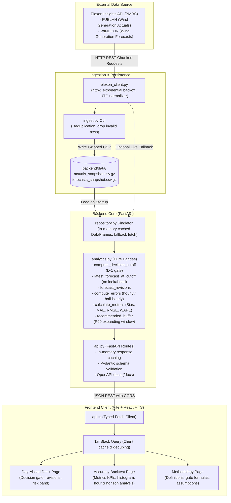
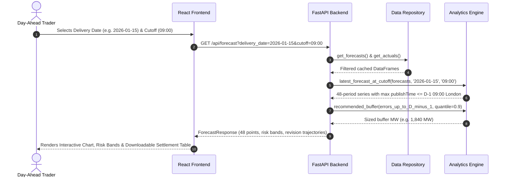
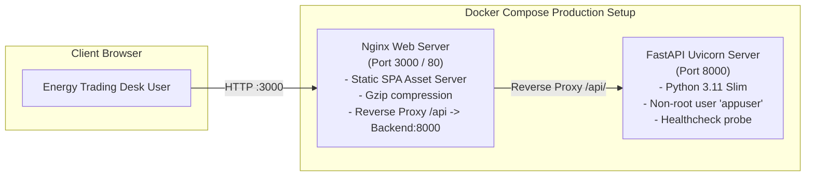

# System Architecture & Data Flow

This document details the architectural design, data processing pipeline, and technical specifications for the **UK Wind Power Trading Desk** decision-support platform.

---

## 1. High-Level Architecture Overview

The system is organized into a clean, layered architecture with strict separation of concerns, zero business logic in the view layer, and mathematically pure domain analytics.

---

## 2. Core Subsystems

### 2.1 Ingestion Layer (`backend/app/elexon_client.py`, `backend/app/ingest.py`)
- **HTTP Transport**: Built with `httpx` supporting connection pooling, timeout budgets (15s default), and exponential backoff retry strategies (up to 3 retries with jitter).
- **Date Chunking**: Elexon API restricts date ranges to 7 days per call. The client automatically chunks multi-week date intervals into 1-day windows to prevent gateway timeouts.
- **Timestamp Normalization**: All incoming ISO-8601 timestamps are parsed and converted to timezone-aware UTC (`datetime.timezone.utc`).
- **Compact Persistence**: Ingested datasets are saved as compressed CSV (`.csv.gz`) files in `backend/data/`. This keeps repository footprint minimal (~1.5 MB total for >100,000 rows) while allowing rapid in-memory decompression.

### 2.2 Domain Analytics Engine (`backend/app/analytics.py`)
All analytics functions are implemented as pure, side-effect-free, fully typed Pandas routines:
1. **Decision Gate Cutoff (`compute_decision_cutoff`)**:
   - Converts delivery date $D$ to trading day $D-1$.
   - Computes cutoff time in `Europe/London` timezone (e.g. 09:00 or 11:00 London time) and normalizes to UTC, accounting for British Summer Time (BST) transitions.
2. **Latest Forecast at Cutoff (`latest_forecast_at_cutoff`)**:
   - Strictly enforces the auction gate constraint:
     $$\text{publishTime} \le \text{cutoff}_{\text{UTC}}$$
   - Filters target day delivery periods and selects the row with the maximum `publishTime` per settlement period.
   - Prevents lookahead bias by discarding any forecast published after the auction gate.
3. **Forecast Revisions (`forecast_revisions`)**:
   - Extracts all preceding forecast iterations published prior to the gate to visualize forecast trajectory and volatility.
4. **Error Modeling (`compute_errors`)**:
   - Calculates half-hourly and hourly forecast error:
     $$\text{Error}_t = \text{Forecast}_t - \text{Actual}_t$$
   - Handles positive errors (over-forecasting) and negative errors (under-forecasting).
5. **Statistical Metrics (`calculate_metrics`)**:
   - **Bias (Mean Error)**: $\frac{1}{N} \sum (\text{Forecast} - \text{Actual})$
   - **Mean Absolute Error (MAE)**: $\frac{1}{N} \sum |\text{Forecast} - \text{Actual}|$
   - **Root Mean Squared Error (RMSE)**: $\sqrt{\frac{1}{N} \sum (\text{Forecast} - \text{Actual})^2}$
   - **Weighted Absolute Percentage Error (WAPE)**: $\frac{\sum |\text{Forecast} - \text{Actual}|}{\sum \text{Actual}} \times 100\%$
   - **P90 Over-Forecast Error**: 90th percentile of $\max(\text{Forecast} - \text{Actual}, 0)$
6. **Expanding-Window Safety Buffer (`recommended_buffer_expanding_window`)**:
   - Sizing the safety band for day $D$ using strictly past days $[D_{start}, D-1]$.
   - Guarantees true out-of-sample backtesting without future information leakage.

### 2.3 Application & API Layer (`backend/app/api.py`, `backend/app/repository.py`)
- **Repository Singleton**: Thread-safe in-memory cache loaded once on application startup.
- **REST API Endpoints**:
  - `GET /api/health`: Service health and uptime status.
  - `GET /api/meta`: Available delivery dates, default cutoff, and dataset version metadata.
  - `GET /api/forecast`: 48 half-hourly delivery periods with latest forecast, horizon, earlier revision history, and asymmetric P90 risk bands.
  - `GET /api/actuals`: Realized actual generation for post-auction backtesting.
  - `GET /api/accuracy/summary`: High-level desk KPIs across the entire month.
  - `GET /api/accuracy/daily`: Day-by-day error metrics with expanding buffer tracking.
  - `GET /api/accuracy/by-hour`: Diurnal intraday performance across 24 settlement hours.
  - `GET /api/accuracy/by-horizon`: Accuracy degradation aggregated across forecast horizons (0-6h, 6-12h, 12-24h, 24-48h, 48h+).
  - `GET /api/accuracy/distribution`: Error histogram frequency distribution (500 MW bins).
- **In-Memory Query Cache**: 5-minute TTL cache on parameterized analytics requests for sub-10ms response times.

### 2.4 Frontend Layer (`frontend/src/`)
- **Vite + React 18 + TypeScript**: Strict type safety end-to-end matching backend Pydantic schemas.
- **State Management**: TanStack Query (`@tanstack/react-query`) handles automated background caching, deduplication, and refetching.
- **Visualization**: Recharts composable charts styled with custom tooltips, reference lines, and responsive SVG containers.
- **Design System**: Vanilla CSS and Tailwind CSS using a dark navy palette (`#0a0f1d`), teal primary (`#14b8a6`), amber risk accent (`#f59e0b`), and clean 8px spacing grid.

---

## 3. Data Flow Progression

---

## 4. Deployment Architecture

- **Containerization**: Multi-stage Docker builds reduce image sizes and isolate build dependencies.
- **Security**: Backend runs as unprivileged user (`appuser`, UID 10001); Nginx handles security headers (`X-Frame-Options`, `X-Content-Type-Options`).
- **Zero-Dependency Cold Start**: Pre-packaged CSV.gz data snapshots ensure the container starts in under 2 seconds without requiring external network connectivity during boot.
